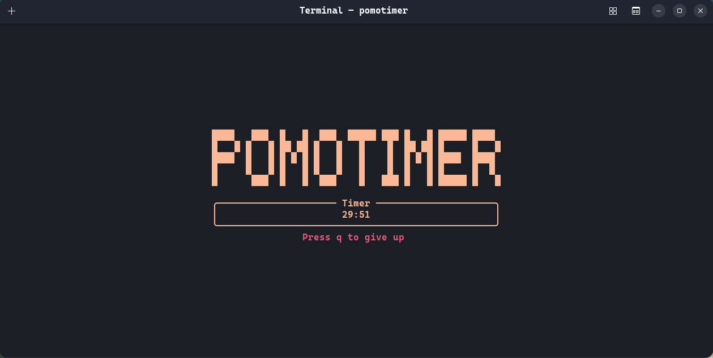

# ⏲️ Pomotimer

> Simple CLI apps based on rust for pomodoro timer


---

## ✨ Features
* ⚡ **Fast & Light**: Built with rust for better performance.
* 🥚 **Easy and Simple**: Easy and simple to use (See Usage).

---

## 💻 Usage

* Just type `pomotimer` on the terminal and be productive, it will set timer 
30 minutes and break 10 minutes
* For spesific use `pomotimer 50 10`, it will set 50 minutes timer and 10 minutes break.

## 🚀 Installation

```bash
curl -fsSL https://raw.githubusercontent.com/pakeelz/pomotimer/main/install.sh | bash
```
